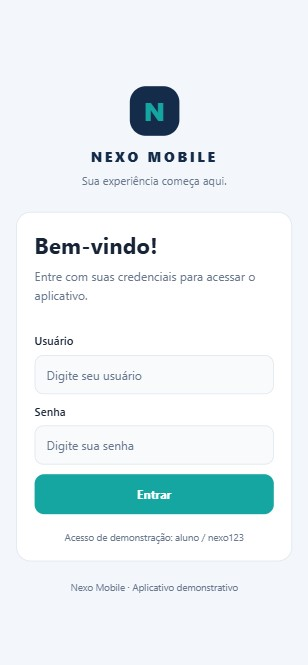
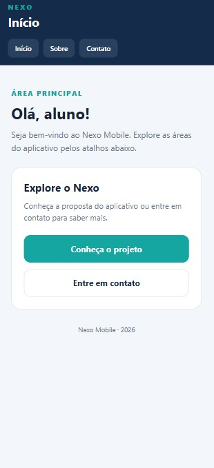
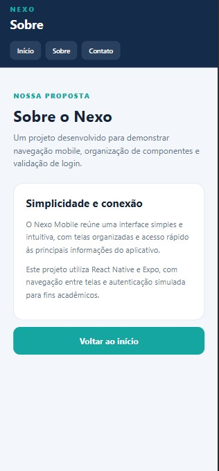
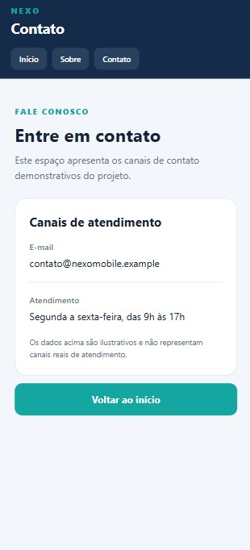

 <div align="center">
  
</div>

# Nexo Mobile — Programação para Dispositivos Móveis

Aplicação mobile desenvolvida como atividade prática da disciplina de **Programação para Dispositivos Móveis**, com o objetivo de demonstrar a implementação de login simulado, navegação entre telas e utilização de uma toolbar.

O projeto foi desenvolvido utilizando React Native e Expo, com uma interface organizada, componentes reutilizáveis e navegação entre as telas de Início, Sobre e Contato.

---

## Sobre o projeto

O **Nexo Mobile** é uma aplicação demonstrativa que reúne funcionalidades básicas de um aplicativo mobile, explorando conceitos de interface, organização de código, validação de formulários e navegação entre páginas.

A aplicação conta com uma tela inicial de login, na qual o usuário deve informar credenciais de teste para acessar as demais funcionalidades.

> **Curso:** Desenvolvimento de Software Multiplataforma  
> **Instituição:** FATEC Itaquera  
> **Disciplina:** Programação para Dispositivos Móveis  
> **Aplicação:** Nexo Mobile  
> **Framework:** React Native  
> **Plataforma de desenvolvimento:** Expo

---

## Funcionalidades

- **Login simulado:** validação dos campos de usuário e senha.
- **Validação de credenciais:** identificação de campos vazios e dados incorretos.
- **Tela inicial:** apresentação e acesso às principais áreas do aplicativo.
- **Tela Sobre:** informações sobre a proposta e as tecnologias utilizadas.
- **Tela Contato:** apresentação de informações demonstrativas de contato.
- **Toolbar:** navegação entre Início, Sobre e Contato.
- **Navegação entre telas:** acesso às páginas e retorno à tela inicial.
- **Interface padronizada:** utilização de estilos e componentes reutilizáveis.

A autenticação é exclusivamente demonstrativa. O projeto não utiliza banco de dados, API ou armazenamento persistente de sessão.

---

## Credenciais de teste

As credenciais abaixo devem ser utilizadas para acessar a aplicação durante a avaliação.

| Campo | Credencial |
|---|---|
| Usuário | `aluno` |
| Senha | `nexo123` |

**Comportamento esperado:**

- Campos vazios: exibição de mensagem solicitando o preenchimento.
- Credenciais incorretas: exibição de mensagem de erro.
- Credenciais válidas: acesso à tela Início.
- Reinicialização do aplicativo: retorno à tela de Login.

---

## Tecnologias utilizadas

- **[React Native](https://reactnative.dev/):** desenvolvimento da interface mobile.
- **[Expo](https://expo.dev/):** ambiente de desenvolvimento e execução da aplicação.
- **[React Navigation](https://reactnavigation.org/):** gerenciamento da navegação entre telas.
- **JavaScript:** implementação da lógica e dos componentes.
- **StyleSheet:** organização e definição dos estilos visuais.
- **Git e GitHub:** versionamento e disponibilização do código-fonte.

---

## Como executar o projeto

### Pré-requisitos

- Node.js e npm instalados.
- Git para clonar o repositório, caso necessário.

### 1. Clonar o repositório

```bash
git clone <https://github.com/uBenetti/nexo-mobile>
```

Entre na pasta do projeto:

```bash
cd nexo-mobile
```

### 2. Instalar as dependências

```bash
npm install
```

### 3. Iniciar a aplicação

Para iniciar o ambiente Expo:

```bash
npx expo start
```

Para executar a versão web, caso o ambiente esteja configurado para isso:

```bash
npx expo start --web
```

Siga as instruções apresentadas no terminal para abrir a aplicação no ambiente disponível.

---

## Estrutura do projeto

```text
📦 nexo-mobile
├── 📁 assets/
├── 📁 src/
│   ├── 📁 components/
│   │   ├── 📄 AppToolbar.js
│   │   └── 📄 PrimaryButton.js
│   ├── 📁 navigation/
│   │   └── 📄 AppNavigator.js
│   ├── 📁 pages/
│   │   ├── 📄 LoginScreen.js
│   │   ├── 📄 HomeScreen.js
│   │   ├── 📄 AboutScreen.js
│   │   └── 📄 ContactScreen.js
│   └── 📁 styles/
│       ├── 📄 colors.js
│       └── 📄 globalStyles.js
├── 📄 App.js
├── 📄 app.json
├── 📄 index.js
├── 📄 package.json
├── 📄 package-lock.json
└── 📄 README.md
```

A organização separa as telas, os componentes reutilizáveis, a configuração de navegação e os estilos, facilitando a manutenção e a compreensão do código-fonte.

---

## Capturas de tela

As imagens abaixo devem apresentar o funcionamento da aplicação. Substitua os caminhos indicados pelos arquivos reais das capturas de tela adicionadas ao repositório.

### Login

Tela de autenticação simulada, com campos de usuário e senha e validação das credenciais.



### Início

Tela principal apresentada após a validação das credenciais.



### Sobre

Tela com informações sobre a proposta do Nexo Mobile.



### Contato

Tela com informações demonstrativas de contato.



---

## Objetivo acadêmico

Este projeto tem como objetivo aplicar, na prática, os conceitos de desenvolvimento mobile estudados durante a disciplina, incluindo:

- Construção de interfaces com React Native.
- Organização do código em componentes e telas.
- Validação de formulários e credenciais.
- Implementação de navegação entre páginas.
- Aplicação de estilos consistentes.
- Versionamento e documentação de software.

---

## Autor

<div align="center">

**Pedro Benetti**

Estudante de **Desenvolvimento de Software Multiplataforma — FATEC Itaquera**.

[](https://instagram.com/o.pedrobenetti)

[](mailto:pedrobenetti587@gmail.com)

[](https://www.linkedin.com/in/o-pedrobenetti/)

---

<p align="center">
  Desenvolvido durante a disciplina de <strong>Programação para Dispositivos Móveis</strong> 📱
</p>


</div>